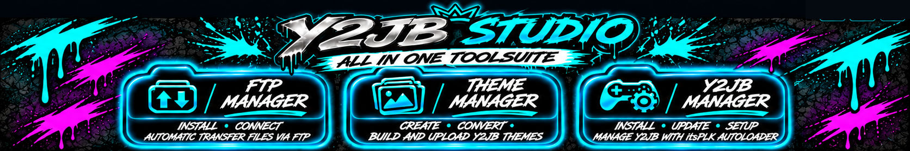

# Y2JB Studio

### Ein Arbeitsplatz. Drei Manager. Dein PS5-Homebrew-Workflow.

**Prüfen · Herunterladen · Installieren · Erstellen · Übertragen**  
Ein buttongeführter PS5-Homebrew-Workflow für Windows.

**Sprache:** [English](README.md) · **Deutsch** · [Español](README.es.md) · [Français](README.fr.md) · [Português](README.pt.md)

[**Y2JB Studio v1.0 herunterladen**](https://github.com/mrguddi84-bit/Y2JB-Studio/releases/latest) · [Schnellstart](#-schnellstart) · [Funktionen](#-funktionen) · [Credits](#-credits-und-danksagungen)

---

## ✨ Y2JB Studio kennenlernen

Y2JB Studio vereint PS5-Verbindungsprüfungen, FTP-Einrichtung, Y2JB-Verwaltung und Theme-Erstellung in einer Windows-App. Die Manager führen mit klaren Statusanzeigen durch unterstützte Downloads, Übertragungen und Einrichtungsschritte.

| FTP Manager | Y2JB Manager | Theme Manager |
| --- | --- | --- |
| FTP prüfen, unterstützte Payloads herunterladen und Zugang einrichten. | Y2JB-Voraussetzungen prüfen, Dateien laden und Übertragung durchführen. | Themes aus PNG-Dateien erstellen, bauen und übertragen sowie unterstützte App-Namen bearbeiten. |
| **Erkennen · Laden · Einrichten · Verbinden** | **Prüfen · Laden · Übertragen · Aktualisieren** | **Erstellen · Bauen · Hochladen · Umbenennen** |

> Y2JB Studio ist ein unabhängiges Homebrew-Projekt der Community und steht in keiner Verbindung zu Sony Interactive Entertainment.

## 🚀 Funktionen

### 📊 Dashboard — Verbindung und Bereitschaft im Überblick

- PS5-Verbindungsstatus anzeigen und prüfen, ob ein FTP-Dienst erreichbar ist.
- Prüfen, ob der konfigurierte ELF Loader auf Port **9021** antwortet.
- Schreibgeschützte Prüfungen für Y2JB-Zielordner, benötigte Icon-Dateien und Icon-Schutzstatus ausführen.
- Bereitschaftsdiagnosen für Theme-Übertragungen und Voraussetzungen des App-Namen-Editors anzeigen.
- Verfügbarkeit von `app.db` und `appinfo.db` prüfen.
- Status von FTP Manager, Y2JB Manager und Theme Manager auf einen Blick sehen.

Diagnosen sind schreibgeschützt und ändern PS5-Dateien nicht absichtlich.

### 🌐 FTP Manager — geführte Einrichtung externer Payloads

- Prüfen, ob ein FTP-Dienst auf der PS5 erreichbar ist.
- Unterstützte Payloads wie [**ftpsrv**](https://github.com/ps5-payload-dev/ftpsrv) oder [**zftpd**](https://github.com/seregonwar/zftpd#-best-setup) bei Bedarf aus den jeweiligen Upstream-Projekten herunterladen. **Keine der beiden Payloads ist in Y2JB Studio enthalten.**
- Durch unterstützte Übertragungs- und Einrichtungsschritte führen, damit die Payload im PS5 Payload Manager verfügbar gemacht werden kann.
- Nach dem Start eines FTP-Dienstes Dateien übertragen.

ELF Loader und FTP-Server sind getrennte Dienste. Für die Ersteinrichtung kann Y2JB Studio den erreichbaren ELF Loader verwenden, um eine unterstützte Payload zu starten.

### ⚙️ Y2JB Manager — Einrichtung und Aktualisierung

- Konsolenregion erkennen und passende Y2JB-Dateien auswählen.
- Benötigte Dateien herunterladen und SHA-256-Prüfsummen kontrollieren.
- Geführte FTP-Übertragungen an das vorgesehene PS5-Ziel ausführen.
- Den YouTube-/Y2JB-Installationsstatus prüfen und unterstützte Einrichtung oder Updates durchführen.
- Die YouTube-PKG-Installation über **Prospero Manager** wurde vom Projektinhaber erfolgreich getestet.
- Y2JB-App-Namen mit dem integrierten Editor und dessen Backup-Schutz bearbeiten.

### 🎨 Theme Manager — erstellen, bauen, hochladen und umbenennen

- PNG-Icons und Hintergründe aus eigenen Ordnern auswählen.
- Ein Y2JB-kompatibles Theme-Paket konvertieren und erstellen.
- Projekte in der lokalen Theme-Bibliothek speichern, öffnen, importieren und verwalten.
- Unterstützte Theme-Dateien per FTP auf die PS5 übertragen.
- Unterstützte Y2JB-App-Namen mit dem Backup-Workflow bearbeiten.

### 🌍 Fünf Oberflächensprachen

Deutsch · English · Español · Français · Português

Die ausgewählte Sprache bleibt für spätere Starts gespeichert.

## 📦 Voraussetzungen

- Ein **Windows-PC**.
- Eine **gejailbreakte PS5** mit **ELF Loader (elfldr), erreichbar auf Port 9021**.

PC und PS5 müssen sich über das Netzwerk erreichen können. Y2JB Studio kann weitere unterstützte FTP- und Y2JB-Komponenten über die Manager herunterladen und einrichten. Für Downloads wird Internetzugang benötigt.

## ⚡ Schnellstart

1. **Y2JB_Studio_v1.0_Portable.exe** von den [GitHub-Releases](https://github.com/mrguddi84-bit/Y2JB-Studio/releases/latest) herunterladen.
2. Die portable EXE unter Windows starten; eine Installation ist nicht nötig.
3. Die PS5-IP im Dashboard eintragen und Verbindungs- sowie Bereitschaftsprüfungen starten.
4. Im **FTP Manager** FTP prüfen oder die geführte Payload-Einrichtung verwenden.
5. Im **Y2JB Manager** die Region prüfen, benötigte Dateien laden und die geführten Einrichtungsschritte ausführen.
6. Im **Theme Manager** aus PNG-Dateien ein Theme erstellen, bauen und per FTP hochladen.

Vor Änderungen wichtige Konsolendaten sichern und Ziel sowie Bestätigungsdialoge bei Übertragungen oder Datenbankbearbeitung prüfen.

## 🛡️ Sicherheit und Netzwerk

FTP-Verbindungen sind unverschlüsselt. Verwende ein vertrauenswürdiges lokales Netzwerk und prüfe die PS5-Adresse vor Dateiübertragungen. Einrichtungsaktionen, Transfers und Änderungen von App-Namen können Konsolendaten verändern. Bewahre Backups auf.

## 🤝 Credits und Danksagungen

Entwickelt von **MrGee mit Unterstützung durch KI**.

| Projekt / Mitwirkende | Beitrag |
| --- | --- |
| [itsPLK](https://github.com/itsPLK/ps5-y2jb-autoloader) | Y2JB Autoloader für den Y2JB-Workflow |
| [ftpsrv-Mitwirkende](https://github.com/ps5-payload-dev/ftpsrv) | Externe PS5-FTP-Payload; wird bei Bedarf geladen, nicht mitgeliefert |
| [Seregon und zftpd-Mitwirkende](https://github.com/seregonwar/zftpd#-best-setup) | Externe PS5-FTP-Payload; wird bei Bedarf geladen, nicht mitgeliefert |
| TheWizWikii / PS5-Stuff | YouTube-PKG-Quellen, auf die die App verweist |
| Qt for Python, Python, Pillow, ispc_texcomp, certifi, Tcl/Tk und PyInstaller | Frameworks, Laufzeit und Verpackung |

Weitere Angaben: [CREDITS.md](CREDITS.md), [THIRD_PARTY_LICENSES.md](THIRD_PARTY_LICENSES.md) und [LICENSE](LICENSE). Drittanbieterkomponenten behalten ihre jeweiligen Lizenzen.

## 📄 Release und Prüfsumme

Das öffentliche Repository enthält Dokumentation und Banner, keinen Anwendungscode. Die portable App wird über die Releases verteilt. Die SHA-256-Prüfsumme steht in [RELEASE_CHECKSUMS.txt](RELEASE_CHECKSUMS.txt).

## 📣 Releases und Support

- [Releases herunterladen](https://github.com/mrguddi84-bit/Y2JB-Studio/releases)
- [Fehler melden oder Funktionen vorschlagen](https://github.com/mrguddi84-bit/Y2JB-Studio/issues)

Füge bei Fehlerberichten Studio- und Windows-Version, betroffenen Manager und Reproduktionsschritte hinzu. Veröffentliche keine Konsolen-Zugangsdaten oder privaten Netzwerkdetails.
