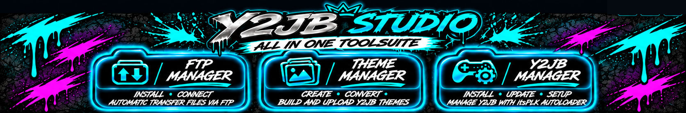

# Y2JB Studio

### Un espacio de trabajo. Tres gestores. Tu flujo homebrew para PS5.

**Comprobar · Descargar · Instalar · Crear · Transferir**  
Un flujo de trabajo homebrew para PS5 guiado por botones en Windows.

**Idioma:** [English](README.md) · [Deutsch](README.de.md) · **Español** · [Français](README.fr.md) · [Português](README.pt.md)

[**Descargar Y2JB Studio v1.0**](https://github.com/mrguddi84-bit/Y2JB-Studio/releases/latest) · [Inicio rápido](#-inicio-rápido) · [Funciones](#-funciones) · [Créditos](#-créditos-y-agradecimientos)

---

## ✨ Conoce Y2JB Studio

Y2JB Studio reúne comprobaciones de conexión de PS5, configuración FTP, gestión de Y2JB y creación de temas en una aplicación para Windows. Sus gestores guían las descargas, transferencias y pasos de configuración compatibles con indicadores de estado claros.

| FTP Manager | Y2JB Manager | Theme Manager |
| --- | --- | --- |
| Detecta FTP, descarga payloads compatibles y ayuda a configurar el acceso. | Comprueba los requisitos de Y2JB, obtiene los archivos necesarios y guía su transferencia. | Crea temas con imágenes PNG, los prepara y carga, y permite editar nombres de aplicaciones compatibles. |
| **Detectar · Descargar · Configurar · Conectar** | **Comprobar · Descargar · Transferir · Actualizar** | **Crear · Preparar · Cargar · Renombrar** |

> Y2JB Studio es una herramienta homebrew independiente de la comunidad. No está afiliada ni respaldada por Sony Interactive Entertainment.

## 🚀 Funciones

### 📊 Dashboard — conexión y estado de preparación

- Muestra el estado de conexión de PS5 y comprueba si hay un servicio FTP accesible.
- Comprueba la respuesta del ELF Loader configurado en el puerto **9021**.
- Ejecuta comprobaciones de solo lectura de carpetas de destino de Y2JB, iconos necesarios y protección de iconos.
- Muestra diagnósticos de preparación de transferencias de temas y requisitos para editar nombres de aplicaciones.
- Comprueba si `app.db` y `appinfo.db` están disponibles.
- Muestra el estado de FTP Manager, Y2JB Manager y Theme Manager.

Los diagnósticos son de solo lectura y no modifican intencionadamente los archivos de PS5.

### 🌐 FTP Manager — configuración guiada de payloads externos

- Comprueba si se puede acceder a un servicio FTP de la PS5.
- Descarga payloads compatibles como [**ftpsrv**](https://github.com/ps5-payload-dev/ftpsrv) o [**zftpd**](https://github.com/seregonwar/zftpd#-best-setup) desde sus proyectos originales cuando sea necesario. **Y2JB Studio no incluye ninguno de los dos payloads.**
- Guía los pasos compatibles de transferencia y configuración para dejar el payload disponible en Payload Manager de PS5.
- Permite transferir archivos cuando ya hay un servicio FTP en ejecución.

ELF Loader y el servidor FTP son servicios distintos. Para la primera configuración, Y2JB Studio puede usar el ELF Loader accesible para iniciar un payload compatible.

### ⚙️ Y2JB Manager — instalación y actualizaciones

- Detecta la región de la consola y selecciona los archivos Y2JB correspondientes.
- Descarga los archivos necesarios y comprueba sus hashes SHA-256.
- Guía transferencias FTP protegidas al destino previsto de PS5.
- Comprueba el estado de la instalación de YouTube/Y2JB y guía la configuración o actualización compatible.
- El propietario del proyecto confirmó las pruebas de instalación del PKG de YouTube mediante **Prospero Manager**.
- Edita el nombre de la aplicación Y2JB con el editor integrado y sus copias de seguridad.

### 🎨 Theme Manager — crear, preparar, cargar y renombrar

- Selecciona iconos y fondos PNG desde tus carpetas.
- Convierte y crea un paquete de tema compatible con Y2JB.
- Guarda, abre, importa y organiza proyectos en la biblioteca local de temas.
- Transfiere temas compatibles a PS5 por FTP.
- Edita nombres de aplicaciones Y2JB compatibles con el flujo de copia de seguridad.

### 🌍 Cinco idiomas de interfaz

Deutsch · English · Español · Français · Português

La aplicación conserva el idioma seleccionado para el siguiente inicio.

## 📦 Requisitos

- Un **PC con Windows**.
- Una **PS5 con jailbreak** y **ELF Loader (elfldr) accesible en el puerto 9021**.

El PC y la PS5 deben poder comunicarse por red. Y2JB Studio puede descargar y configurar otros componentes FTP y Y2JB compatibles desde sus gestores. Se necesita Internet para descargar archivos.

## ⚡ Inicio rápido

1. Descarga **Y2JB_Studio_v1.0_Portable.exe** desde [GitHub Releases](https://github.com/mrguddi84-bit/Y2JB-Studio/releases/latest).
2. Ejecuta el EXE portable en Windows; no requiere instalador.
3. Introduce la IP de PS5 en Dashboard e inicia las comprobaciones de conexión y preparación.
4. Abre **FTP Manager** para comprobar FTP o seguir la configuración guiada del payload.
5. Abre **Y2JB Manager** para comprobar la región, descargar los archivos necesarios y seguir la configuración guiada.
6. Abre **Theme Manager** para crear un tema con PNG, prepararlo y cargarlo por FTP.

Haz copias de seguridad antes de cambiar datos de la consola. Comprueba el destino y los avisos de confirmación antes de transferir o editar bases de datos.

## 🛡️ Seguridad y red

Las conexiones FTP no están cifradas. Usa una red local de confianza y confirma la dirección de PS5 antes de transferir archivos. La configuración, las transferencias y la edición de nombres pueden cambiar datos de la consola. Conserva tus copias de seguridad.

## 🤝 Créditos y agradecimientos

Desarrollado por **MrGee con asistencia de IA**.

| Proyecto / colaboradores | Contribución |
| --- | --- |
| [itsPLK](https://github.com/itsPLK/ps5-y2jb-autoloader) | Y2JB Autoloader para el flujo Y2JB |
| [Colaboradores de ftpsrv](https://github.com/ps5-payload-dev/ftpsrv) | Payload FTP externo para PS5; se descarga cuando se necesita, no está incluido |
| [Seregon y colaboradores de zftpd](https://github.com/seregonwar/zftpd#-best-setup) | Payload FTP externo para PS5; se descarga cuando se necesita, no está incluido |
| TheWizWikii / PS5-Stuff | Fuentes del PKG de YouTube enlazadas por la aplicación |
| Colaboradores de Qt for Python, Python, Pillow, ispc_texcomp, certifi, Tcl/Tk y PyInstaller | Frameworks, runtime y empaquetado |

Más información: [CREDITS.md](CREDITS.md), [THIRD_PARTY_LICENSES.md](THIRD_PARTY_LICENSES.md) y [LICENSE](LICENSE). Los componentes externos conservan sus licencias respectivas.

## 📄 Release y verificación

El repositorio público contiene documentación y el banner, no el código fuente de la aplicación. La aplicación portable se distribuye en Releases. El hash SHA-256 figura en [RELEASE_CHECKSUMS.txt](RELEASE_CHECKSUMS.txt).

## 📣 Releases y soporte

- [Descargar releases](https://github.com/mrguddi84-bit/Y2JB-Studio/releases)
- [Informar de un error o solicitar una función](https://github.com/mrguddi84-bit/Y2JB-Studio/issues)

Al informar de un error, incluye las versiones de Studio y Windows, el gestor afectado y los pasos para reproducirlo. No publiques credenciales de la consola ni detalles privados de la red.
