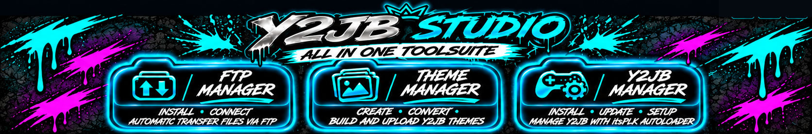

# Y2JB Studio

### Um espaço de trabalho. Três gestores. O seu fluxo homebrew para PS5.

**Verificar · Descarregar · Instalar · Criar · Transferir**  
Um fluxo homebrew para PS5, guiado por botões, no Windows.

**Idioma:** [English](README.md) · [Deutsch](README.de.md) · [Español](README.es.md) · [Français](README.fr.md) · **Português**

[**Descarregar Y2JB Studio v1.0**](https://github.com/mrguddi84-bit/Y2JB-Studio/releases/latest) · [Início rápido](#-início-rápido) · [Funcionalidades](#-funcionalidades) · [Créditos](#-créditos-e-agradecimentos)

---

## ✨ Conheça o Y2JB Studio

O Y2JB Studio reúne verificações de ligação à PS5, configuração FTP, gestão Y2JB e criação de temas numa aplicação Windows. Os gestores orientam as transferências, downloads e passos de configuração suportados com indicadores de estado claros.

| FTP Manager | Y2JB Manager | Theme Manager |
| --- | --- | --- |
| Detetar FTP, descarregar payloads suportados e configurar o acesso. | Verificar os requisitos Y2JB, obter os ficheiros necessários e orientar a transferência. | Criar temas com imagens PNG, preparar e carregar temas, e editar nomes de aplicações suportados. |
| **Detetar · Descarregar · Configurar · Ligar** | **Verificar · Descarregar · Transferir · Atualizar** | **Criar · Preparar · Carregar · Renomear** |

> O Y2JB Studio é uma ferramenta homebrew independente da comunidade. Não é afiliado nem apoiado pela Sony Interactive Entertainment.

## 🚀 Funcionalidades

### 📊 Dashboard — ligação e estado de preparação

- Mostrar o estado da ligação à PS5 e verificar se um serviço FTP está acessível.
- Verificar se o ELF Loader configurado responde na porta **9021**.
- Executar verificações só de leitura das pastas Y2JB, ficheiros de ícone necessários e proteção dos ícones.
- Mostrar diagnósticos de preparação de transferências de temas e requisitos para editar nomes de aplicações.
- Verificar a disponibilidade de `app.db` e `appinfo.db`.
- Consultar o estado do FTP Manager, Y2JB Manager e Theme Manager num só lugar.

Os diagnósticos são só de leitura e não alteram intencionalmente ficheiros da PS5.

### 🌐 FTP Manager — configuração guiada de payloads externos

- Verificar se existe um serviço FTP acessível na PS5.
- Descarregar payloads suportados, como [**ftpsrv**](https://github.com/ps5-payload-dev/ftpsrv) ou [**zftpd**](https://github.com/seregonwar/zftpd#-best-setup), dos respetivos projetos originais quando necessário. **Nenhum dos payloads está incluído no Y2JB Studio.**
- Orientar os passos suportados de transferência/configuração para disponibilizar um payload no Payload Manager da PS5.
- Transferir ficheiros quando um serviço FTP estiver em execução.

O ELF Loader e um servidor FTP são serviços distintos. Na configuração inicial, o Y2JB Studio pode usar o ELF Loader acessível para iniciar um payload suportado.

### ⚙️ Y2JB Manager — instalação e atualizações

- Detetar a região da consola e selecionar os ficheiros Y2JB correspondentes.
- Descarregar os ficheiros necessários e verificar os respetivos hashes SHA-256.
- Orientar transferências FTP protegidas para o destino previsto na PS5.
- Verificar o estado da instalação YouTube/Y2JB e orientar a configuração ou atualização suportada.
- O proprietário do projeto confirmou os testes de instalação do PKG do YouTube através do **Prospero Manager**.
- Editar o nome da aplicação Y2JB com o editor integrado e as respetivas cópias de segurança.

### 🎨 Theme Manager — criar, preparar, carregar e renomear

- Selecionar ícones e fundos PNG a partir das suas pastas.
- Converter e preparar um pacote de tema compatível com Y2JB.
- Guardar, abrir, importar e organizar projetos na biblioteca local de temas.
- Transferir temas suportados para a PS5 por FTP.
- Editar nomes de aplicações Y2JB suportados com o fluxo de cópia de segurança.

### 🌍 Cinco idiomas de interface

Deutsch · English · Español · Français · Português

A aplicação guarda o idioma selecionado para os próximos arranques.

## 📦 Requisitos

- Um **PC com Windows**.
- Uma **PS5 com jailbreak** e **ELF Loader (elfldr) acessível na porta 9021**.

O PC e a PS5 têm de comunicar pela rede. O Y2JB Studio pode descarregar e configurar os restantes componentes FTP e Y2JB suportados através dos gestores. É necessária ligação à Internet para os downloads.

## ⚡ Início rápido

1. Descarregue **Y2JB_Studio_v1.0_Portable.exe** em [GitHub Releases](https://github.com/mrguddi84-bit/Y2JB-Studio/releases/latest).
2. Execute o EXE portátil no Windows; não é necessário instalador.
3. Introduza o IP da PS5 no Dashboard e inicie as verificações de ligação e preparação.
4. Abra o **FTP Manager** para verificar FTP ou seguir a configuração guiada do payload.
5. Abra o **Y2JB Manager** para verificar a região, obter os ficheiros necessários e seguir a configuração guiada.
6. Abra o **Theme Manager** para criar um tema com PNGs, prepará-lo e carregá-lo por FTP.

Faça cópias de segurança dos dados importantes da consola antes de qualquer alteração. Confirme o destino e os avisos antes de transferir ou editar bases de dados.

## 🛡️ Segurança e rede

As ligações FTP não são encriptadas. Utilize uma rede local de confiança e confirme o endereço da PS5 antes das transferências. A configuração, as transferências e a edição de nomes podem alterar dados da consola. Guarde as cópias de segurança.

## 🤝 Créditos e agradecimentos

Desenvolvido por **MrGee com assistência de IA**.

| Projeto / colaboradores | Contributo |
| --- | --- |
| [itsPLK](https://github.com/itsPLK/ps5-y2jb-autoloader) | Y2JB Autoloader usado no fluxo Y2JB |
| [Colaboradores do ftpsrv](https://github.com/ps5-payload-dev/ftpsrv) | Payload FTP externo para PS5; descarregado quando necessário, não incluído |
| [Seregon e colaboradores do zftpd](https://github.com/seregonwar/zftpd#-best-setup) | Payload FTP externo para PS5; descarregado quando necessário, não incluído |
| TheWizWikii / PS5-Stuff | Fontes do PKG do YouTube referenciadas pela aplicação |
| Colaboradores do Qt for Python, Python, Pillow, ispc_texcomp, certifi, Tcl/Tk e PyInstaller | Frameworks, runtime e empacotamento |

Mais informações: [CREDITS.md](CREDITS.md), [THIRD_PARTY_LICENSES.md](THIRD_PARTY_LICENSES.md) e [LICENSE](LICENSE). Os componentes de terceiros mantêm as respetivas licenças.

## 📄 Release e verificação

O repositório público contém documentação e o banner, não o código-fonte da aplicação. A aplicação portátil é distribuída nas Releases. O hash SHA-256 consta em [RELEASE_CHECKSUMS.txt](RELEASE_CHECKSUMS.txt).

## 📣 Releases e suporte

- [Descarregar releases](https://github.com/mrguddi84-bit/Y2JB-Studio/releases)
- [Comunicar um problema ou sugerir uma funcionalidade](https://github.com/mrguddi84-bit/Y2JB-Studio/issues)

Ao comunicar um problema, indique as versões do Studio e do Windows, o gestor afetado e os passos para reproduzir. Não publique credenciais da consola nem detalhes privados da rede.
